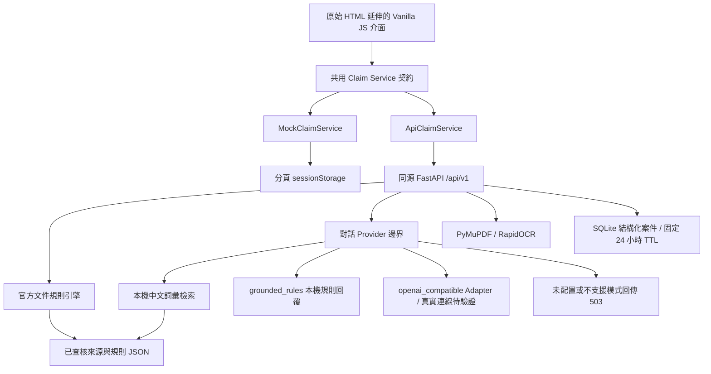

# 專案架構

更新日期：2026-10-17（臺灣）。本文描述目前程式與功能邊界，不代表 Phase 2 或 Phase 3 已通過驗收。階段證據請見 [Phase 1 驗收](PHASE1_ACCEPTANCE.md) 與 [續作狀態](../STATUS.md)。

## 元件與資料流

| 層次 | 程式位置 | 職責 |
|---|---|---|
| 介面 | `index.html`、`src/app.js`、`src/components.js`、`src/styles/` | 雙入口、類別確認、清單、聊天、上傳、預覽與摘要；延續既有品牌、版面與互動 |
| 服務 | `src/services/` | 相同方法切換 Mock 或 HTTP，統一錯誤與結構化回傳 |
| HTTP | `backend/app/main.py`、`models.py` | FastAPI 路由、Pydantic 驗證、來源與上傳限制、案件存取 |
| 官方資料 | `data/official-sources.json`、`backend/app/registry.py`、`rules.py` | 官方來源、文件定義、條件規則與出處；未知條件維持人工確認 |
| 對話與檢索 | `backend/app/ai/` | 分類提案、準備問答、來源驗證與無依據處理 |
| 文件分析 | `backend/app/ocr/analyzer.py` | 實際 PDF 文字擷取或本機圖片 OCR、指定欄位檢查、位置與信心資訊 |
| 案件保存 | `backend/app/store.py` | owner 隔離、SQLite 結構化資料、刪除、數量限制與到期清理 |

## 前端與服務契約

前端以 hash 導覽串接 `triage`、`assistant`、`search`、`workspace`、`summary`。頁面讀取服務回傳狀態，不以自由文字自行判定文件是否通過。需求類型 `requirement_type`、適用性 `applicability` 與準備狀態 `status` 分開管理。

服務選擇順序為網址 `?service=mock|api`、建置設定 `VITE_SERVICE_MODE`、預設 `mock`。API 模式失敗不會退回 Mock。Mock 明確回傳 `provider: mock`、`is_simulated: true`；其分析情境是固定示意，與上傳內容無關。完整方法、端點與資料型別見 [API 契約](API_CONTRACT.md)。

HTTP adapter 僅允許同源相對路徑，預設 `/api/v1`，攜帶同源 cookie，不跟隨重新導向。FastAPI 可供應建置後的 `dist/`、`assets/` 與 `pdfjs/`；Vite 開發時透過 `/api` proxy 連到後端。正式來源及 TLS 設定依部署文件與實測結果確認。

引導回覆只提出 `proposed_case_updates`；使用者確認後才呼叫 PATCH 更新案件。更改條件會重新計算清單，依文件 ID 保留既有分析。人工確認僅記錄已讀的 finding ID，不刪除疑點、不提高信心，也不產生核准結論。

## 官方規則、檢索與 Provider

官方入口是 [法國巴黎人壽理賠程序](https://life.cardif.com.tw/zh/a314)。來源索引保留網址、查核日、文件版本、頁碼與引用關係；規則與原文歧義見 [來源查核紀錄](OFFICIAL_SOURCES.md)。執行期讀取本機已查核資料，不會依使用者提供的網址抓取內容。

規則引擎支援住院醫療、醫療門診、防癌或重大疾病。條件判斷保留 `true`、`false`、未知三種結果；未知不等於免附。規則本身要求人工確認時，即使部分條件不成立，也保留確認提示。

`OfficialRetriever` 對知識段落、文件規則、來源差異及送件說明建立本機索引，以中文字雙字詞、同義詞及加權詞彙重疊排序，依理賠類別限制檢索。目前沒有向量資料庫；預設模式直接以本機規則回覆，可選外部 Adapter 整理已檢索證據。

`ConversationProvider` 是可替換的非同步介面。預設 `LLM_PROVIDER=grounded_rules` 實際執行本機規則與檢索，回傳 `is_simulated: false`，但不是生成式 LLM，`llm_configured=false`。

可選的 `openai_compatible` 已實作於 `backend/app/ai/openai_compatible.py`，以後端 HTTP client 呼叫 `/chat/completions`。後端設定 `LLM_BASE_URL` 預設為 `https://api.openai.com/v1`；`LLM_API_KEY`、`LLM_MODEL` 都無預設，外部模式必填，且不預選模型。缺少必要設定或設定無效會回 503，不支援的模式仍走 `UnavailableLLMProvider`。外部失敗不回退成本機規則或 Mock 成功結果。

外部 Adapter 先套用本機規則：類別／條件提案、安全拒答及無依據問題仍由規則回答；只有有證據支持的文件準備回答會呼叫模型。傳送內容限本次檢索的標題、完整段落、來源 ID 與頁碼，不傳原始上傳文件、案件物件、使用者問題或對話歷史。模型只能選取原樣的完整證據段落，不能新增事實、生成網址或更新案件；伺服器驗證引用後從 registry 還原官方連結。

Adapter 已通過離線 HTTP transport 測試，尚未驗證真實模型請求；Phase 2 真實 LLM 驗收仍為 BLOCKED。健康檢查不呼叫模型，`llm_configured=true` 只表示外部必要設定齊備；本版 `llm_verified` 固定為 `false`，`health.status=ok` 也不能證明外部連線通過。配置、安全邊界與測試狀態以 [LLM 整合紀錄](LLM_INTEGRATION.md) 為準。

回覆先通過結構與來源驗證，再由 Pydantic 及 API 檢查。引用須對應已查核來源、官方網址與有效頁碼。超出小型資料庫支持範圍時回覆不確定；資格、給付、法律或醫療結論不由準備助手推定。

## 實際文件分析

API 接受 PDF、JPG、PNG，檢查非空、大小、副檔名、MIME 與檔案標頭；上限為 10 MB、PDF 10 頁、圖片解壓縮後 2,000 萬像素。加密、損壞或格式不符的文件回結構化錯誤。

PyMuPDF 優先擷取 PDF 原生文字；缺少足夠文字的頁面先轉圖片，與 JPG／PNG 一樣先做實際清晰度量測。符合既有品質條件才交由 RapidOCR 本機 CPU 模型處理；不足頁保留頁碼並跳過模型。全部跳過時回 `provider=quality_precheck`、空欄位與逐頁品質提示，明示未執行 OCR；有實際擷取時依處理方式回 `pdf_text` 或 `rapidocr`。三者均 `is_simulated=false`。只要有品質不足頁、低信心或未可靠辨識內容，整體仍 `uncertain` 並要求人工確認，品質門檻不當作官方要求。

只有清單項目 `application` 有指定欄位規則：被保人姓名、保單號碼、身分證字號、申請項目及簽署日期；這不是所有官方表單欄位的完整驗證。受益人簽名一律要求人工確認。其他文件只擷取文字並提示人工核對，不自動宣告通過。

分析位置使用頁碼及 0–1 正規化座標。前端用本機 PDF.js 畫布或暫時圖片 URL 顯示原檔，疊加提醒；未找到欄位時的預設框是提示區域，不能當成精確偵測位置。原始文件與抽取全文不寫入案件庫，欄位值使用遮罩；前端暫時 URL 在關閉或換檔時釋放。重新整理後若要看原件，必須重新選取檔案。

## 保存、隔離與可靠性

API 以隨機 HttpOnly、SameSite=Strict 的 `claim_session` cookie 識別 owner，資料庫只保存 owner 雜湊。這是展示案件隔離，並非會員登入或正式身分驗證。每個 owner 最多 20 件，每案最多 100 回成功對話（200 則 user／assistant 訊息）。

SQLite 保存類別、條件、對話、文件中繼資料、遮罩欄位及分析結果，仍應視為敏感資料。案件建立後固定保存 24 小時，修改不延長；啟動、資料讀寫及每 300 秒清理到期資料。使用者也可明確刪除本次案件。資料庫預設 `.local/cases.sqlite3`，可用 `CASE_DB_PATH` 指定；不承諾對檔案系統備份或磁碟快照完成安全抹除。

API 有受限來源、request 大小、安全回應標頭、程序內的 128 把案件非同步鎖，以及每程序每連線 IP 的請求頻率限制；預設每 60 秒 120 次，可由環境設定。本版必須使用單一 Uvicorn worker、單一 app 副本；程序內鎖無法協調多 worker 的案件讀改寫，可能造成更新遺失，速率限制也不跨程序共享。多程序或水平擴充前，須加入資料庫版本／CAS 或其他跨程序一致性控制與集中配額。這些措施適用原型，不能代替正式服務的登入授權、稽核及資料治理。

HTTP adapter 一般操作預設 15 秒逾時，文件分析另設 95 秒；後端對話上限 45 秒、分析路由上限 90 秒，OCR 內部另有 45 秒檢查。前端逾時不保證後端立即取消處理；細節與重試方式見 [已知限制](KNOWN_LIMITATIONS.md)。

## 驗證與交付邊界

前端單元測試在 `tests/*.test.js`，Mock／PDF／API 瀏覽器測試分別由 Playwright 設定管理，後端測試在 `backend/tests/`。[展示腳本](DEMO.md) 使用 `demo/documents/` 的合成文件；文件本身不是官方申請書或正式醫療資料。

Docker 與公開 HTTPS 部署是否實際建置、啟動及驗證，應依執行紀錄與驗收報告判定；設定檔或 `compose config` 解析成功不代表容器執行或外部部署成功。此原型沒有理賠送件 API。
