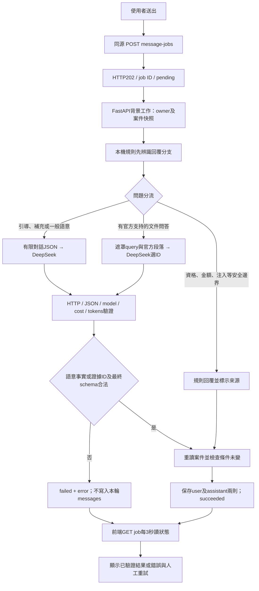

# 模型請求與除錯流程

更新：2026-10-20（臺灣）。依目前程式實際流程整理；不是通用OpenRouter範例。金鑰值、原始醫療描述與模型原始回覆不應貼入日誌或公開紀錄。

## 本次錯誤的定位

使用者提供「可能是重大疾病，但我還不確定」。公開程序的安全日誌兩次記錄：

```text
LLM validation rejected stage=validate_semantics line=126 field=emergency
```

這是修正前commit `6250a55` 的行號。原規則只要整則回答包含「癌症／重大疾病／確診」，且question不是critical_diagnosis、fact不是yes就拒絕，沒有區分不確定重述與診斷肯定。`field=emergency` 是前一迴圈留下的欄位名，不能據此判斷急診事實出錯。

同句、空白合成案件的一次真實重現：OpenRouter HTTP200、精確模型1017、six facts全unknown、question=care_setting、36字回覆同時有重大疾病詞／不確定詞／就醫詞且無禁止詞，最終於同126行FAIL。費用US$0.001536384；沒有保存原始回覆。這證明本次錯誤落在本機語意驗證，不是缺官方引用、沒有接上API或模型逾時。此重現不代表已讀到使用者原案件的完整對話；原案與job沒有被安全日誌逐一關聯。

合理行為應保留未確定狀態，追問必要資訊，不宣稱重大疾病已確診，也不產生重大疾病清單。修復與實際重驗結果見本頁最後段落。

## 端到端路徑



前端在建立工作後開始輪詢，不是等模型完成才取得job ID。圖中的錯誤分支表示工作已終止；前端不自動再送一個模型請求。

1. [src/app.js](../src/app.js) 的guided與workspace兩個入口，都使用 [ApiClaimService.sendMessage](../src/services/api-claim-service.js)。busy期間停用送出；不是瀏覽器直接呼叫OpenRouter。
2. POST `/api/v1/cases/{case_id}/message-jobs`，內容為 `{message, document_id?}`。帶同源session cookie；私有金鑰不送前端。
3. [main.py](../backend/app/main.py) 驗證owner、案件／文件、訊息上限、同案無其他處理中工作；取得快照後交給 [MessageJobManager](../backend/app/message_jobs.py)。HTTP202僅代表已排入背景工作，不代表模型成功。
4. `complete_message → validated_conversation_response → conversation.respond → OpenAICompatibleProvider.respond`。每次先執行本機規則辨別分支，再決定是否送外部模型，不是每一則回答都由LLM生成。
5. 完成外部與最終schema驗證後重新取得案件鎖，核對owner／未刪除、claim type與conditions仍等於快照。只有成功才同時保存本輪user與assistant兩則；對話提案本身不直接更新官方清單。
6. 前端每3秒GET同一job。成功才更新case及畫面；失敗顯示error，保留輸入供人工重試。未通過的本輪提問與回答都不會進成功歷史，後續模型不會自動記得那次失敗內容。

## 三種分流與外送內容

| 分流 | 模型實際取得 | 模型輸出與伺服器處理 |
| --- | --- | --- |
| 安全／範圍邊界 | 不呼叫模型 | 規則拒絕判資格、金額、核准、改規則等；仍明示本機來源 |
| 語意引導 | `{dialogue, confirmed_case}` | `{facts, question, message}`；伺服器驗證引文、未知／否定、追問與候選 |
| 官方文件問答 | `{query, evidence:[{id,title,text}]}` | 只回`{evidence_ids:[...]}`，最多3個；伺服器重建完整官方段落、URL及頁碼 |

語意的dialogue包含本次必要訊息及最多8則合格歷史，最多9則／合計6000字。當前原文與遮罩後皆須1–4000字；歷史user最多1000、assistant最多600，只留完整安全句段、必要短答前問句及最後引導回覆。文件問答、分析內容及不明配對排除。**不是完整案件記憶。**

confirmed_case只含已確認claim_type_id與conditions.cause／surgery；不附整案、文件／OCR、cookie、key。文件問答只附本次遮罩query，不附對話歷史或confirmed_case。遮罩是盡力辨識明顯姓名、電話、身分證、地址、保單號與憑證，並非全面去識別保證。

OpenRouter外層messages固定兩則：system prompt加上一則JSON字串user content。多輪歷史放在該JSON的dialogue內，**不是把完整歷史直接展開成外部messages陣列**。系統提示原文可直接讀 [semantic_dialogue.py的SYSTEM_PROMPT](../backend/app/ai/semantic_dialogue.py)；文件選證據提示位於 [openai_compatible.py](../backend/app/ai/openai_compatible.py)。

## 真正的OpenRouter請求

後端經httpx送 `POST https://openrouter.ai/api/v1/chat/completions`，Authorization由後端環境取得。沒有自動重試、其他模型／供應商fallback或規則／Mock假成功。

```json
{
  "model": "deepseek/deepseek-v4.1-flash-1017",
  "messages": [
    {"role": "system", "content": "<所選profile的系統提示>"},
    {"role": "user", "content": "<所選profile輸入的JSON字串>"}
  ],
  "response_format": {"type": "json_object"},
  "stream": false,
  "store": false,
  "max_completion_tokens": 4096,
  "provider": {
    "only": ["deepseek"],
    "max_price": {"prompt": 0.3, "completion": 1.2, "request": 0, "image": 0},
    "require_parameters": true,
    "allow_fallbacks": false
  },
  "reasoning": {"effort": "low"}
}
```

4096為語意分支上限，官方證據分支1800；不是字數，也不保證所有預算都能用來產生可見回答。`store:false` 不代表供應商保留政策已受驗收。單價cap的prompt／completion單位為美元／百萬token；request／image是固定費率，0不代表整次模型免費。

## 回傳依序驗證什麼

| 階段 | 主要驗證 | 失敗表現 |
| --- | --- | --- |
| 外部傳輸 | 300秒、禁止redirect、回覆≤64KiB、HTTP200 | 逾時LLM_TIMEOUT；429為LLM_RATE_LIMITED；其他傳輸問題LLM_PROVIDER_ERROR；超64KiB為INVALID_LLM_RESPONSE |
| JSON與metadata | model精確1017或canonical20261017；cost有限0–US$0.05；三項正整數token及加總相符，completion不超當次cap | INVALID_LLM_RESPONSE |
| 完成狀態 | choices恰1、finish_reason=stop；無refusal／tool_calls；content可解析JSON | INVALID_LLM_RESPONSE；length也拒絕 |
| 語意profile | 六facts精確schema、已知值有允許user turn逐字quote、否定／不確定不作肯定；未知不得推出住院／確診，追問須對應未知，message≤500字且無禁止內容 | INVALID_LLM_RESPONSE |
| 證據profile | 根鍵只能evidence_ids、1–3個唯一且存在於本次檢索白名單 | INVALID_LLM_RESPONSE |
| 最終公開回覆 | AssistantResponse schema、合法官方URL／source／page、非模擬，案件未變更 | INVALID_AI_RESPONSE／INVALID_PROVIDER_RESPONSE／MESSAGE_CASE_CHANGED等 |

六facts為cause、inpatient、outpatient、emergency、critical_diagnosis、surgery。cause為unknown/accident/illness，其餘unknown/yes/no；unknown必須turn=null、quote空字串。這裡的「事實來源」是user對話引文，與文件問答的「官方引用」不同。

對本次句子的合法內部回覆可如下（格式示意，不是假稱取得的原始模型回覆）：

```json
{
  "facts": {
    "cause": {"value":"unknown","turn":null,"quote":""},
    "inpatient": {"value":"unknown","turn":null,"quote":""},
    "outpatient": {"value":"unknown","turn":null,"quote":""},
    "emergency": {"value":"unknown","turn":null,"quote":""},
    "critical_diagnosis": {"value":"unknown","turn":null,"quote":""},
    "surgery": {"value":"unknown","turn":null,"quote":""}
  },
  "question": "care_setting",
  "message": "了解，目前仍不確定。請問這次是否已就醫，以及有沒有住院？"
}
```

這些facts不直接公開到UI；伺服器轉成AssistantResponse的clarification、missing_information、空suggested_claim_types／updates等欄位。因沒有確認事實，不能直接跳成critical_illness候選或建立文件清單。

多個 `_invalid()` 原先共用「外部模型回覆缺少可驗證的引用或超出允許範圍」訊息；本次改為「外部模型回覆未通過格式、內容或來源驗證，請稍後重試」，錯誤碼與狀態不變。**仍須用安全stage／line分辨JSON、token、來源或語意錯誤**，不能由共用中文訊息判根因。費用0.05美元是回傳後接受檢查，不能取消已產生費用。

後端拒絕回覆不代表供應商沒執行或免費：本次重現的模型已完成推論並回傳cost，接著才被本機規則拒絕。再次手動送出會是新的付費請求。

## 在瀏覽器與後端除錯

瀏覽器開F12 → Network，篩選 `message-jobs`，送出一則不含個資的測試。

```text
POST /cases/<case>/message-jobs        HTTP202 {id, status:"pending"}
GET  /cases/<case>/message-jobs/<job>  HTTP200 {id, status:"pending"}
GET  /cases/<case>/message-jobs/<job>  HTTP200 {id, status:"failed", error:{...}}
```

本次錯誤的最後GET可為HTTP200，**body的error.status才是503**，error.code是INVALID_LLM_RESPONSE；不要只看Network整排200就認為模型通過。同步相容`/messages`才會直接HTTP503，現在網頁不用該長等待端點。

```json
{
  "id": "<同一個job UUID>",
  "status": "failed",
  "error": {
    "code": "INVALID_LLM_RESPONSE",
    "message": "<共用驗證失敗訊息>",
    "status": 503
  }
}
```

可在專案根目錄只讀當前安全日誌：

```powershell
Get-Content .local/uncertain-dialogue-20261020/app-safe.stderr.log -Tail 30
```

更新／重啟後請依 [STATUS](../STATUS.md) 的新日誌路徑。stage為_request_json先查回覆大小／JSON／完成狀態；_openrouter_metadata查model／cost／tokens；validate_semantics對照當時版本行號；respond查evidence_ids。現有日誌沒有request ID／時間戳或原始內容，不能直接將每行配對到特定原案件；重啟與程式變更後，舊行號不能拿來套新source。

前端總等待330秒、後端整體310秒、模型300秒；每次POST／GET最長15秒且受剩餘總時間限制。背景工作最多16並行、128保留、TTL900秒，僅單worker記憶體；重啟清除工作。模型失敗不改case，手動點「重試」才會建立新工作與新模型請求，也可能再次計費。斷線不等於後端已取消；同案仍執行時再送會409，owner不符／過期job為404。

`/api/v1/health` 不呼叫模型。`llm_configured=true`只表示配置可用；`llm_verified=true`只表示同程序／同配置之前曾成功，不會因這次被拒就自動歸零，不能拿它判斷當前這一則是否成功。要看相同job ID的terminal狀態。

不要把Authorization、Cookie、完整prompt／回覆或含個資的HAR貼到對話。通常只需記錄case/job的本機識別、時間、error.code與安全stage／line，再用無個資句子重現。

## 本次修復與驗證

修正已發布到原公開網址，模型／key／300秒／官方文件規則未變。舊全句veto改為逐子句核對使用者已提出的同一疾病疑慮，只允許有依據的不確定重述；「尚未確診」須使用者明講，不能從「我不確定」推定。未知下的確診肯定、無據否認、新癌症、跨句／「且」及就醫詞洗白仍拒絕。新例外對未識別的癌字詞採保守拒絕，不是本輪新增所有癌症病名辨識。

TDD先取得3個合法措辭誤擋RED／10個拒絕負例PASS，再補同句就醫語意洗白RED。覆核另發現「疑似重大疾病」後附加「您有肺癌」或「肺癌尚未確診」被初修例外放行，兩個完整adapter負例先RED後修，沒有隱藏。最終語意79項、指定5檔相關測試455項（3.85秒）、全後端652項（35.91秒，既有Starlette warning1）全過。

同句直接真探測：修正前HTTP200後在舊126行FAIL；初修後HTTP200、六facts unknown、care_setting／clarification、無候選／updates PASS，費用US$0.0009579。最後癌字邊界只收緊新癌症例外，不更改合法原句；最終程序再由桌面1440及手機390各一次真UI job，**2/2 PASS／27.922秒**，均非模擬AI、無肯定診斷／候選／updates／type／docs／PATCH，成功才保存兩則訊息；無console／pageerror或水平溢出，兩個合成案件DELETE後404。沒有自動重試或另加模型probe。

最終映像 `cardif-claim-preparation:uncertain-safe-20261020`／`sha256:a54e187ac8158ef0e80c99b3f9fd156b38a9e941fa1bac464d65d07fa606a74f` 真build且224同路徑hash與主機一致；空.local、無環境檔／資料庫，離線臨時容器已清理。未重跑未變的前端69、完整15回覆三尺寸／OCR／容器持久性，這些是[上一輪差異證據](DEEPSEEK_SETUP.md)，不當作本輪重跑。有限規則與語意驗證仍不等於全面語言正確性證明。

完整安全紀錄：[修正前](uncertain-dialogue-20261020/before.json)、[初修真重驗](uncertain-dialogue-20261020/after.json)、[最終UI兩案](uncertain-dialogue-20261020/ui-final.json)、[最終離線測試](uncertain-dialogue-20261020/tests.json)、[映像核對](uncertain-dialogue-20261020/image-safe-check.json)。沒有保存原始模型回覆、醫療文件或cookie。最終runtime與log位置見[STATUS](../STATUS.md)。
